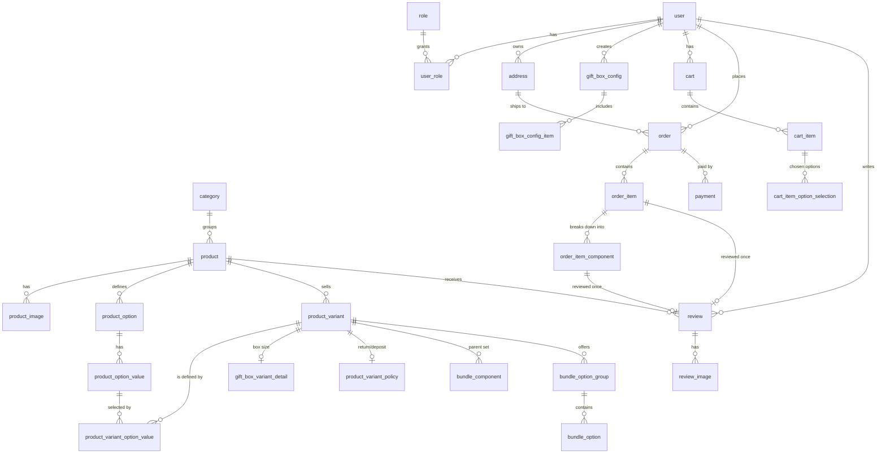

# Thiết kế cơ sở dữ liệu — Giftly

> Nguồn: `Giftly_Database_Design_Updated.md` (bản đầy đủ nhất) và `Giftly_Database.sql` của nhóm Backend — PostgreSQL 15+, khoá chính UUID, tên `snake_case`, **27 bảng**. FE và mock bám đúng thiết kế này. Bản DB **không** chạy trên DB cũ đã có dữ liệu (giá/tồn kho chuyển từ `product` sang `product_variant`, cần migration riêng).

## 1. Bốn luồng mua sắm

1. **Ready-made Gift Set** — set quà lắp sẵn (`READY_MADE_GIFT_SET`) có cấu trúc bundle: thành phần cố định + nhóm tuỳ chọn (thiệp, phụ kiện).
2. **Regular Product** — sản phẩm lẻ (`REGULAR`).
3. **Ready-made Gift Box** — hộp bán riêng (`READY_MADE_GIFT_BOX`), có kích thước lòng hộp; cũng là hộp chứa của Custom Box.
4. **Custom Gift Box** — `gift_box_config` của khách: một hộp + các món hợp lệ. Không phải `product_type`.

## 2. Sơ đồ quan hệ

## 3. Bảng và ánh xạ sang FE

| Nhóm | Bảng | Ghi chú / trường FE |
|---|---|---|
| Người dùng | `user`, `role`, `user_role`, `address` | `status` ACTIVE/INACTIVE/SUSPENDED; `ROLE_USER`, `ROLE_ADMIN` |
| Danh mục | `category`, `product`, `product_image` | `product_type`, `status`, `is_custom_box_eligible`; ảnh có `product_variant_id` (NULL = ảnh chung). **Giá và tồn kho không còn ở `product`** |
| Biến thể | `product_option`, `product_option_value`, `product_variant`, `product_variant_option_value` | `Product.options[]`, `Product.variants[]`; SKU duy nhất; mỗi biến thể có giá, tồn kho, kích thước, khối lượng, `status` |
| Chi tiết biến thể | `gift_box_variant_detail`, `product_variant_policy` | `variant.giftBoxDetail` (lòng hộp, tải trọng); `variant.policy` (`is_perishable`, `shelf_life_hours`, `return_policy`, `advance_payment_percent`) |
| Bundle | `bundle_component`, `bundle_option_group`, `bundle_option` | `variant.bundle.components[]` / `optionGroups[].options[]` (`pricing_mode` FREE/PRODUCT_PRICE/FIXED_PRICE) |
| Hộp tùy chỉnh | `gift_box_config` (`box_variant_id`), `gift_box_config_item` | `GiftBoxView.box` + `items[]` |
| Giỏ hàng | `cart`, `cart_item`, `cart_item_option_selection` | `cart_item`: **đúng một** trong `product_variant_id` / `gift_box_config_id`; `selection` lưu `bundle_option_id`, `message_text`, `message_rendering_method` |
| Đơn hàng | `order`, `order_item`, `order_item_component` | `order.required_advance_amount`; `order_item` và `component` lưu snapshot tên, SKU, `variant_snapshot` (JSONB), giá, chính sách, tiền cọc, lời chúc |
| Thanh toán | `payment` | `payment_stage` FULL/ADVANCE/REMAINING; một đơn có nhiều `payment` |
| Đánh giá | `review`, `review_image` | đúng một nguồn mua (`order_item_id` hoặc `order_item_component_id`), `rating` 1–5, không có trạng thái duyệt |

## 4. Enum

| Enum | Giá trị |
|---|---|
| `product_type` | REGULAR, READY_MADE_GIFT_SET, READY_MADE_GIFT_BOX, PACKAGING_ACCESSORY, GREETING_CARD |
| `product_status` / `variant_status` | AVAILABLE, OUT_OF_STOCK, DISCONTINUED |
| `dimension_unit` / `weight_unit` | MM, CM, M / G, KG |
| `bundle_component_role` | BOX, PRODUCT, ACCESSORY, GREETING_CARD |
| `bundle_selection_type` / `bundle_pricing_mode` | SINGLE, MULTIPLE / FREE, PRODUCT_PRICE, FIXED_PRICE |
| `message_rendering_method` | HANDWRITTEN, PRINTED |
| `return_policy` | RETURNABLE, NO_RETURN |
| `order_status` | PENDING_CONFIRMATION → CONFIRMED → PROCESSING → PACKAGING → READY_TO_SHIP → SHIPPING → DELIVERED → COMPLETED; CANCELLED, RETURN_REQUESTED, RETURNED, FAILED |
| `payment_method` / `payment_status` / `payment_stage` | CREDIT_CARD, DEBIT_CARD, BANK_TRANSFER, E_WALLET, COD / PENDING, PAID, FAILED, REFUNDED / FULL_PAYMENT, ADVANCE_PAYMENT, REMAINING_PAYMENT |

## 5. Quy tắc nghiệp vụ (service enforce — mock đã mô phỏng)

- **Giá theo ngữ cảnh**: phụ kiện đóng gói mua riêng = giá biến thể; trong set hoặc hộp tùy chỉnh = 0; thiệp trong nhóm tuỳ chọn theo `pricing_mode`; thiệp trong hộp tùy chỉnh = giá biến thể. Server tính, không tin client.
- **Miễn phí vẫn trừ kho.**
- **Tồn kho set quà**: tồn kho biến thể set là số set đã lắp sẵn → không trừ lại thành phần cố định; lựa chọn thêm (thiệp, giấy gói…) trừ kho riêng.
- **Chính sách tổng hợp** (set, hộp tùy chỉnh): có thành phần `NO_RETURN` → cả dòng `NO_RETURN`; tỷ lệ cọc = **cao nhất** trong các thành phần. Ví dụ 1.000.000₫ với cọc 50% → cọc 500.000₫.
- **Ràng buộc SQL**: hàng dễ hỏng phải `NO_RETURN` và cọc ≥ 50%; cọc 0–100.
- **Snapshot khi checkout** vào `order_item`/`order_item_component`; đơn cũ không đổi khi sản phẩm đổi giá/chính sách.
- **Custom Box**: không lồng set; `REGULAR` cần `is_custom_box_eligible`; `box_variant_id` thuộc `READY_MADE_GIFT_BOX`; kiểm tra sức chứa (khối lượng, thể tích) chỉ là xấp xỉ.
- **Review**: đơn của chính người dùng, `DELIVERED`/`COMPLETED`, một nguồn mua một lần; điểm trung bình theo `product_id` gộp mọi biến thể.
- **Tạo đơn** trong một transaction: khoá hàng biến thể (`SELECT … FOR UPDATE`) → kiểm tra tồn (gộp theo biến thể) → trừ kho → ghi order/items/components/payments → làm rỗng giỏ. `CANCELLED`, `FAILED`, `RETURNED` hoàn kho một lần.

## 6. Quy tắc đã chốt trong bản DB cập nhật

Bản `Giftly_Database_Design_Updated.md` đã xác nhận các điểm FE từng phải giả định:

- **COD khi có đặt cọc**: không cho COD khi `order.required_advance_amount > 0`; phải dùng phương thức khác để trả cọc. FE tự chuyển sang chuyển khoản và backend từ chối nếu vẫn gửi COD.
- **Ghi nhận `PAID`**: `ADVANCE_PAYMENT` hoặc `FULL_PAYMENT` không phải COD → khi admin xác nhận đơn (trước đó là `PENDING`); `REMAINING_PAYMENT` không phải COD và mọi khoản COD → khi đơn `DELIVERED`. FE không bao giờ tự đánh dấu đã trả; backend cập nhật trong cùng transaction với việc chuyển trạng thái đơn.
- **Lời chúc trong Custom Box**: thêm `message_text TEXT NULL` và `message_rendering_method NULL` (`HANDWRITTEN`/`PRINTED`) vào `gift_box_config_item`. Lời chúc của lựa chọn trong set vẫn nằm ở `cart_item_option_selection`. Cả hai được sao vào snapshot `order_item_component`.
- **Duyệt hộp vượt kích thước (đề xuất thêm cột)**: vượt sức chứa ≤ 20% vẫn cho tạo. Thêm vào `gift_box_config`: `review_status` (`NOT_REQUIRED`/`PENDING`/`APPROVED`/`REJECTED`, mặc định `NOT_REQUIRED`), `review_note TEXT NULL`, `capacity_ratio NUMERIC(5,2) NULL`, `reviewed_by`/`reviewed_at` (tuỳ chọn), `updated_at`. Khách sửa cấu hình khi chưa `APPROVED`; admin không thể chuyển đơn sang `CONFIRMED` khi còn hộp `PENDING`/`REJECTED`. Đây là phần mở rộng so với DB 27 bảng — cần nhóm Backend xác nhận.
- **Sức chứa hộp**: FE chỉ được từ chối khi tổng thể tích hoặc tổng khối lượng vượt giới hạn quá dung sai; vượt qua kiểm tra này **không** chứng minh xếp vừa. Backend phải tự kiểm tra, việc xếp 3D chính xác là tính năng riêng.

## 7. Điểm FE còn giả định — cần Backend xác nhận

1. **Hoàn cọc**: huỷ/giao thất bại/trả hàng → `PAID → REFUNDED`, `PENDING → FAILED`. Chưa có quy tắc giữ cọc khi khách huỷ.
2. **Yêu cầu trả hàng**: mock chỉ chặn khi *mọi* dòng `NO_RETURN`; trả từng dòng/từng món chưa mô hình hoá (DB không có bảng yêu cầu trả hàng).
3. **Giá thiệp trong Custom Box**: tài liệu ghi "free/paid theo cấu hình" nhưng chưa có bảng cấu hình; FE tính theo giá biến thể.
4. **Giới hạn số món**: FE/mock dùng tối đa 30 món khi hộp thiếu số đo (không có quy tắc chính thức).
5. **Một sản phẩm `READY_MADE_GIFT_BOX` làm món trong Custom Box**: được phép theo DB; Builder hiện chỉ cho chọn `REGULAR` đủ điều kiện, phụ kiện và thiệp (hộp phụ chưa có giao diện).
6. **Đánh giá thành phần**: chỉ hiển thị nút ở thành phần vai trò `PRODUCT`; dòng hộp tùy chỉnh không tự đánh giá.
7. **Admin**: đã quản lý đủ sản phẩm (cha → biến thể), ảnh (URL hoặc tải từ thiết bị — mock trả data URL, backend thật dùng Cloudinary), tuỳ chọn, chính sách, lòng hộp, bundle, danh mục, khách hàng, đánh giá, yêu cầu hộp quà, Dashboard và Analytics. Chưa có: `review_image`. Xoá biến thể/sản phẩm đã có trong đơn hoặc là thành phần của set khác bị từ chối (khoá ngoại) — dùng "Ngừng bán".
8. **Ảnh ER cũ** trong tài liệu nhóm còn mô tả schema trước (có `review.status`, `gift_box_item`); nên cập nhật theo 27 bảng.
