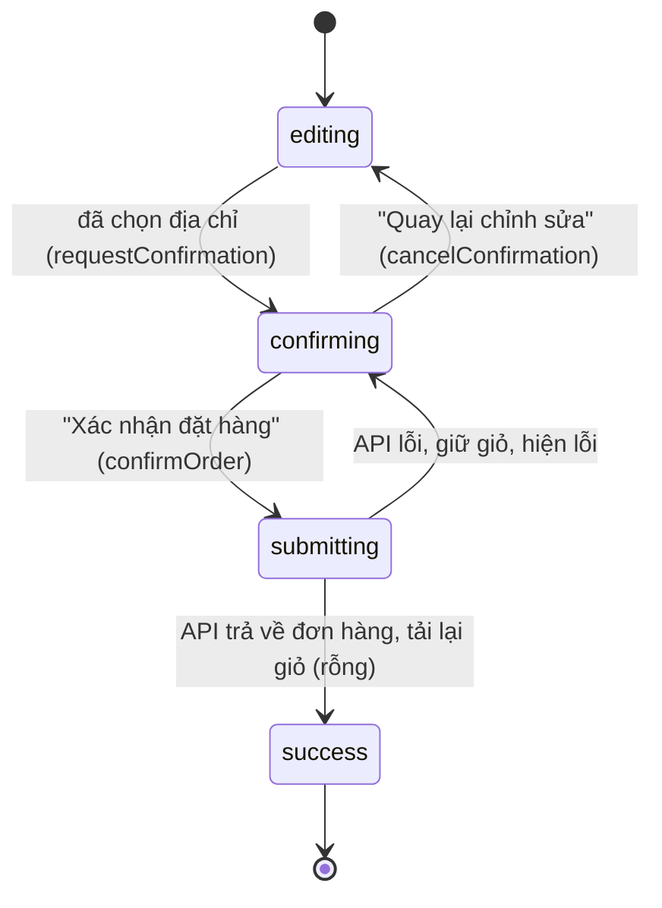
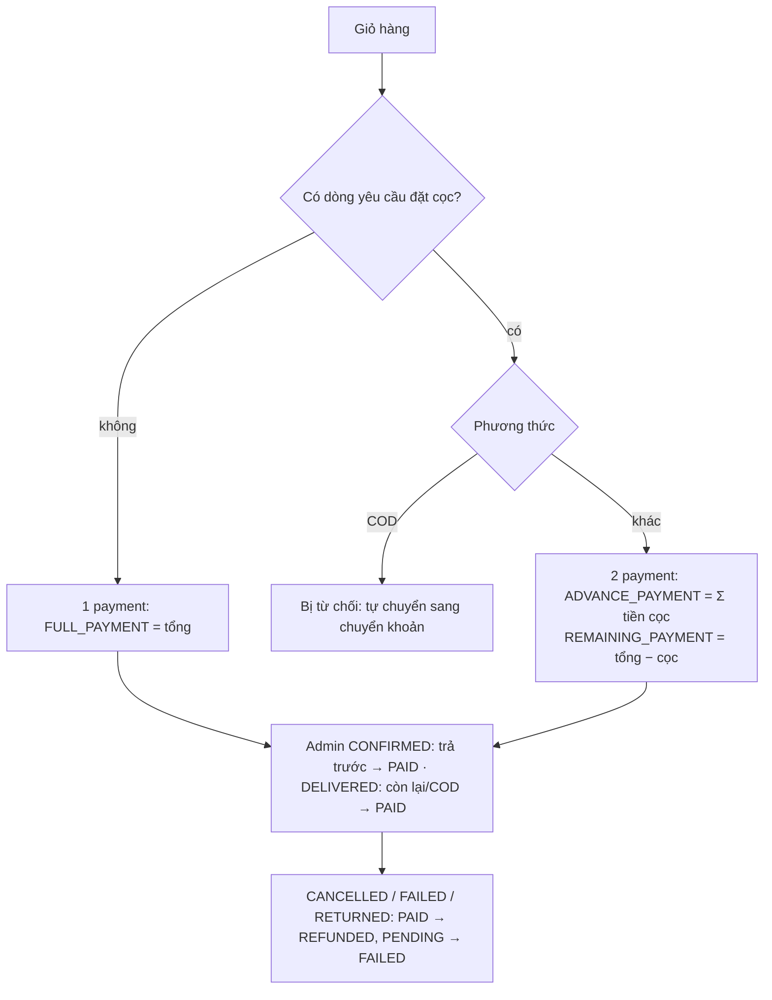
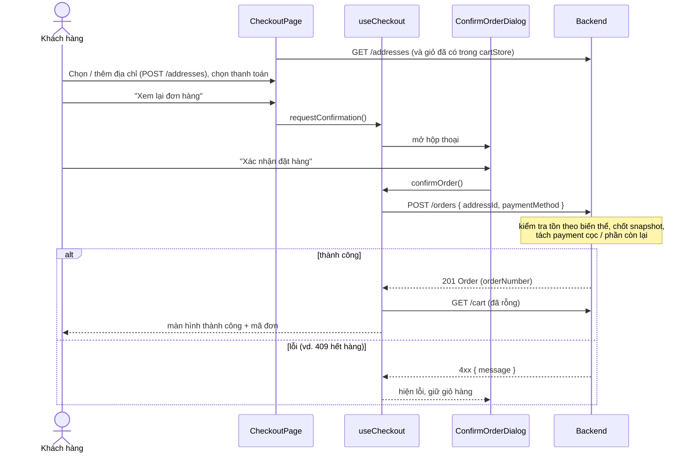

# Luồng đặt hàng (Checkout)

## Máy trạng thái của `useCheckout`

Trong `submitting`, mọi thao tác `confirmOrder` / `cancelConfirmation` bị bỏ qua để tránh gửi lặp.

## Thanh toán theo giai đoạn

## Trình tự

