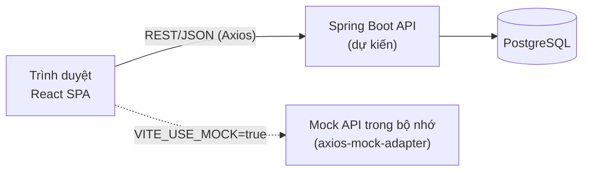

# Kiến trúc hệ thống — Giftly

> Phạm vi hiện tại: **frontend**. Backend (Spring Boot) là thiết kế dự kiến.

## 1. Tổng quan



Khi chưa có backend, bật `VITE_USE_MOCK=true`: mock chặn request ở tầng Axios và trả dữ liệu theo đúng hợp đồng trong `docs/api/api-specification.md`. Chuyển sang backend thật chỉ cần tắt cờ và đặt `VITE_API_BASE_URL`.

## 2. Frontend

### 2.1 Công nghệ
Vite · React 19 · TypeScript strict · Tailwind CSS v4 · shadcn/ui (Radix) · Lucide · Motion · MUI + MUI X DataGrid (chỉ Admin) · Zustand · Axios · React Hook Form + Zod · React Router · Vitest + Testing Library.

### 2.2 Cấu trúc (feature-based)
```
src/
├── app/          router (route guard), AppRoot
├── api/          axios client, ApiError, mock backend
├── components/   ui (shadcn), layout
├── features/     addresses · admin · auth · cart · checkout · gift-builder · home · orders · products
├── lib/          cn, format, useAsync
├── stores/       themeStore, authStore, toastStore
└── styles/       index.css (tokens), fonts.css
```
Quy tắc phụ thuộc chi tiết: `AGENTS.md` mục 3.

### 2.3 Hai “thế giới” giao diện
| Khu vực | UI | Lý do |
|---|---|---|
| Storefront (`/`, `/products`, `/products/:id`, `/builder`, `/signin`, `/register`, `/cart`, `/checkout`, `/orders`) | Tailwind + shadcn + Motion | Nhẹ, tuỳ biến thương hiệu cao |
| Admin (`/admin/*`) | MUI + DataGrid | Bảng dữ liệu, form, dialog dựng sẵn, tiết kiệm thời gian |

Admin được `React.lazy` tách chunk riêng nên khách mua hàng **không** tải MUI. Cả hai dùng chung bảng màu và font: tokens ở `src/styles/index.css`, `createAdminTheme` ở `features/admin/theme/muiTheme.ts`.

### 2.4 Quản lý state
| Loại | Công cụ | Ví dụ |
|---|---|---|
| Phiên đăng nhập, giao diện | Zustand + `persist` | `authStore` (`giftly-auth`), `themeStore` |
| Giỏ hàng (nguồn sự thật ở server) | Zustand (không lưu cục bộ) | `cartStore` — ghi tuần tự, chống lộ giỏ khi đổi tài khoản |
| Dữ liệu từ server theo trang | hook `useAsync` (chống race condition) | `useProducts`, danh sách đơn admin |
| Trạng thái luồng nhiều bước | hook riêng | `useCheckout` (editing → confirming → submitting → success) |
| Trạng thái form | React Hook Form + Zod | form địa chỉ, đăng nhập/đăng ký, form sản phẩm |

### 2.5 Giao tiếp API
- Một `apiClient` duy nhất (`src/api/client.ts`): gắn `Authorization: Bearer` từ `authStore`, timeout 15s; phản hồi `401` khi đang có token → tự đăng xuất.
- Interceptor phản hồi chuẩn hóa mọi lỗi thành `ApiError { message, status }`; UI chỉ hiển thị `message`.
- Mỗi feature có `api/<name>Api.ts`; component không gọi Axios trực tiếp.

### 2.6 Theme & typography
- Chế độ sáng/tối: `themeStore` đặt class `dark` trên `<html>`; mọi màu đi qua CSS variables.
- Chữ **Playfair Display** (có Vietnamese subset). Số hiển thị bằng **Lora** nhờ `@font-face 'Giftly Digits'` giới hạn `unicode-range` ở `0-9 , .` — số tự động đổi font ở mọi nơi.

### 2.7 Luồng đặt hàng
Xem `diagrams/checkout-flow.md`.

## 3. Backend (dự kiến)
- Java 21, Spring Boot, Spring Data JPA, Spring Security, PostgreSQL.
- Phân tầng: Controller → Service → Repository. Validate đầu vào bằng Bean Validation.
- **Backend là nguồn sự thật** cho giá, tồn kho và tổng tiền (FE không được tin cậy).
- Thiết kế CSDL: `database-design.md`.

## 4. Quyết định thiết kế

| # | Quyết định | Lý do |
|---|---|---|
| 1 | Không dùng React Query, tự viết `useAsync` | Giữ ngăn xếp công nghệ đúng đề cương; nhu cầu hiện tại đơn giản. Cân nhắc đổi nếu cần cache/phân trang nhiều |
| 2 | Giỏ hàng lưu trên server theo tài khoản (`cart`/`cart_item`) | Khớp thiết kế DB; giá/tồn kho do server kiểm soát. Hệ quả: phải đăng nhập mới thêm vào giỏ |
| 6 | Route guard `RequireAuth` (+ `useAuthGate` cho hành động) | Chặn `/cart`, `/checkout`, `/orders`, `/admin`; hành động cần đăng nhập chuyển tới `/signin` kèm lý do và trang quay lại |
| 3 | Mock trong `axios-mock-adapter` | Phát triển FE độc lập BE; cùng hợp đồng API |
| 4 | Admin tách chunk bằng `lazy` | MUI nặng, chỉ quản trị viên cần |
| 5 | Dialog dạng bottom-sheet trên mobile | Dễ thao tác bằng một tay |
| 7 | Giá, tồn kho, SKU ở **biến thể**, không ở sản phẩm | Khớp DB 27 bảng; giỏ/đơn/hộp tùy chỉnh đều tham chiếu `product_variant_id` |
| 8 | Chính sách (không đổi trả, đặt cọc) tổng hợp bằng hàm thuần `products/policy.ts`, dùng chung FE và mock | Một quy tắc duy nhất cho giỏ, hộp tùy chỉnh, thanh toán; BE phải cài lại đúng quy tắc này |
| 9 | Đơn hàng đọc snapshot, `orderRules.ts` suy ra “không đổi trả / đã đánh giá” từ snapshot | Lịch sử không đổi khi sản phẩm đổi giá hoặc chính sách |

## 4a. Sản phẩm, biến thể và set quà (`features/products`)
- **Kiểu & quy tắc thuần**: `types.ts` (Product → options → variants → policy/giftBoxDetail/bundle), `productRules.ts` (khoảng giá, tìm biến thể theo lựa chọn, tùy chọn còn hàng), `policy.ts` (`mergePolicies`, `calcAdvanceAmount`).
- **Trang chi tiết** `ProductDetailPage`: `VariantOptionPicker` (chọn màu/cỡ, khoá giá trị hết hàng), `BundleOptionPicker` (nhóm thiệp/phụ kiện của set, lời chúc, viết tay/in), ghi chú chính sách, `ReviewList`.
- **Thẻ sản phẩm**: “Từ <giá thấp nhất>”; thêm nhanh chỉ khi một biến thể và không có nhóm tuỳ chọn, ngược lại dẫn tới trang chi tiết.

## 4b. Gift Box Builder (`features/gift-builder`)
- **Logic thuần** (`giftBox.ts`): chọn hộp (biến thể), thêm/bớt món (tự giới hạn theo tồn kho, sức chứa và 30 món), bật/tắt phụ kiện/thiệp, lời chúc, tính giá (phụ kiện = 0), chính sách tổng hợp, kiểm tra lỗi, `toPayload`.
- **Sức chứa** (`fit.ts`): quy đổi đơn vị (MM/CM/M, G/KG), khối lượng và thể tích đã dùng so với tải trọng/lòng hộp; hiển thị bằng `FitMeter`. Chỉ là điều kiện cần, không chứng minh xếp vừa.
- **Phân loại** (`catalog.ts`, `componentRole.ts`): tách biến thể còn bán thành hộp / món / phụ kiện / thiệp theo `product_type`; set quà không bao giờ vào hộp.
- **Store** `giftBuilderStore` (Zustand, chỉ trong bộ nhớ) giữ bản nháp; `AppRoot` chỉ xoá bản nháp khi đổi/đăng xuất tài khoản, nên khách đăng nhập giữa chừng không mất hộp đang làm.
- **Thêm vào giỏ** (`useAddGiftBoxToCart`): `useAuthGate` → `POST /gift-box-configs` → `POST /cart/items` → reset bản nháp → `/cart`. Giá do server tính.

## 4c. Xác thực (`features/auth`, `stores/authStore`)
- Đăng ký/đăng nhập trả `{ token, user }`; lưu ở `authStore` (persist). `RequireAuth` bảo vệ route theo đăng nhập và vai trò; `UserMenu` ở header, nút đăng xuất ở thanh trên của admin.
- `AppRoot` chạy `useCartSync`: đăng nhập → tải giỏ; đăng xuất/đổi tài khoản → xoá giỏ đang giữ.

## 5. Việc còn lại
- Upload ảnh thật lên Cloudinary (mock trả data URL); ảnh đánh giá (`review_image`).
- Kết nối backend thật; chốt các điểm còn mở ở `database-design.md` mục 6.
