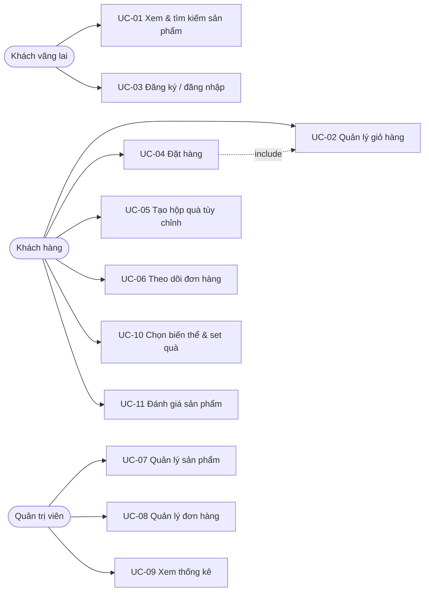

# Use Cases — Giftly

> Trạng thái: **bản nháp v0.2**. Mã `FR-xx` tham chiếu `SRS.md`.

## Sơ đồ tổng quát

## UC-01 — Xem & tìm kiếm sản phẩm (FR-02, FR-03)
- **Tác nhân**: khách vãng lai, khách hàng
- **Luồng chính**: mở “Cửa hàng” → hệ thống hiển thị sản phẩm đang bán (giá “Từ …” nếu nhiều biến thể, điểm đánh giá) → người dùng gõ từ khoá (đợi 300ms) và/hoặc chọn danh mục, loại sản phẩm → danh sách cập nhật.
- **Ngoại lệ**: không có kết quả → hiện trạng thái rỗng; lỗi mạng → hiện thông báo và nút “Thử lại”.

## UC-02 — Quản lý giỏ hàng (FR-04)
- **Tác nhân**: khách hàng đã đăng nhập
- **Tiền điều kiện**: đã đăng nhập. Khách vãng lai bấm “+” hoặc “Thêm vào giỏ hàng” (hộp tùy chỉnh) → chuyển tới `/signin` kèm lý do; sau khi đăng nhập quay lại đúng trang.
- **Luồng chính**: bấm “+” trên thẻ sản phẩm một biến thể (hoặc “Thêm vào giỏ” ở trang chi tiết) → server thêm vào giỏ của người dùng → vào `/cart` để tăng/giảm/xoá. Mỗi dòng hiện biến thể, lựa chọn đã chọn, chính sách (không đổi trả, đặt cọc).
- **Quy tắc**: số lượng ∈ [1, tồn kho của biến thể]; cùng biến thể + cùng lựa chọn thì cộng dồn; giảm về 0 thì xoá dòng; sản phẩm hết hàng không thêm được; giỏ lưu trên server theo tài khoản (đăng xuất/đổi tài khoản không lộ giỏ của người trước); hộp tùy chỉnh luôn số lượng 1.

## UC-03 — Đăng ký / đăng nhập / đăng xuất (FR-01)
- **Luồng chính**: `/register` (họ tên, email, mật khẩu ≥ 8 ký tự, SĐT tuỳ chọn) hoặc `/signin` → server trả JWT + thông tin người dùng → lưu phiên (`giftly-auth`) → về trang đã yêu cầu (hoặc `/`; quản trị viên về `/admin`). “Đăng xuất” ở menu tài khoản (storefront) hoặc thanh trên (admin).
- **Ngoại lệ**: sai email/mật khẩu; tài khoản tạm khoá / không còn hoạt động; email đã đăng ký; token hết hạn (401) → tự đăng xuất.
- **Bảo vệ route**: `/cart`, `/checkout`, `/orders` cần đăng nhập; `/admin/*` cần `ROLE_ADMIN` (khách thường thấy trang 403).

## UC-04 — Đặt hàng (FR-05, FR-06, FR-07)
- **Tiền điều kiện**: đã đăng nhập; giỏ hàng có ít nhất một dòng.
- **Luồng chính**
  1. Người dùng chọn **địa chỉ giao hàng** (mặc định được chọn sẵn) hoặc thêm địa chỉ mới (form kiểm tra hợp lệ), và chọn phương thức thanh toán.
  2. Bấm “Xem lại đơn hàng” → hộp thoại **Xác nhận đơn hàng** hiện người nhận, địa chỉ, thanh toán, số món, phí ship, tổng tiền; nếu có đặt cọc: số tiền **đặt cọc ngay** và **phần còn lại**.
  3. “Xác nhận đặt hàng” → `POST /orders { addressId, paymentMethod }` (server dùng giỏ hàng của người dùng).
  4. Server trả đơn (`orderNumber`) → FE tải lại giỏ (đã rỗng) → màn hình thành công.
- **Luồng thay thế**
  - 1a. Chưa có địa chỉ → hiện form thêm địa chỉ; chưa lưu thì không xem lại đơn được.
  - 2a. “Quay lại chỉnh sửa” → đóng hộp thoại, giữ lựa chọn.
  - 1b. Giỏ có hàng yêu cầu đặt cọc → COD bị khoá, tự chọn chuyển khoản.
  - 3a. Server từ chối (hết hàng…) → hiện lỗi trong hộp thoại, giữ giỏ hàng.
- **Quy tắc**: không gửi lặp khi đang xử lý; hộp thoại không đóng được khi đang gửi.

## UC-05 — Tạo hộp quà tùy chỉnh (FR-10 → FR-14)
- **Tác nhân**: khách hàng (khách vãng lai được thiết kế thử nhưng phải đăng nhập mới thêm vào giỏ)
- **Luồng chính**: `/builder` — 4 bước: **Chọn hộp** → **Chọn món** (+/− số lượng, thanh mức đầy theo khối lượng/thể tích/số món) → **Trang trí** (phụ kiện đóng gói miễn phí, thiệp — tuỳ chọn — mỗi thiệp có lời chúc và viết tay/in) → **Hoàn tất** (xem lại, tổng giá, chính sách tổng hợp). Bấm “Thêm vào giỏ hàng” → `POST /gift-box-configs` rồi `POST /cart/items { giftBoxConfigId }` → sang `/cart`.
- **Luồng thay thế**:
  - Chưa đăng nhập → chuyển `/signin`, **giữ nguyên bản nháp** để làm tiếp sau khi đăng nhập.
  - Món hết tồn, hộp đã đầy (khối lượng/thể tích/30 món) → nút “+” bị khoá; đổi sang hộp nhỏ hơn mà quá đầy → báo ở bước Hoàn tất.
  - Thiếu hộp/món → không sang được bước kế tiếp và không thêm được vào giỏ.
  - Server từ chối (409 hết hàng…) → lỗi hiện ở bước Hoàn tất, giữ bản nháp.
- **Quy tắc nghiệp vụ**:
  - **Giá hộp = giá hộp chứa + Σ (giá món × số lượng)**; phụ kiện đóng gói = 0 (vẫn trừ kho); server tính lại.
  - Hộp chứa là biến thể `READY_MADE_GIFT_BOX`; món gồm `REGULAR` có `is_custom_box_eligible`, phụ kiện, thiệp; **không** có set quà. Chỉ biến thể đang bán và còn hàng.
  - Sức chứa: tổng khối lượng ≤ tải trọng và tổng thể tích bao ngoài ≤ lòng hộp (điều kiện cần, không phải đủ); tối đa **30 món**; lời chúc ≤ 200 ký tự; mỗi hộp tùy chỉnh là một dòng riêng trong giỏ (số lượng 1).
  - **Vượt kích thước chấp nhận được** (≤ 20% khối lượng/thể tích): vẫn thêm được vào giỏ, hiện cảnh báo “chờ xem xét”; admin xem ở “Yêu cầu hộp quà”, liên hệ khách (SĐT/Zalo) rồi duyệt hoặc từ chối kèm lý do. **Khách sửa được tới khi admin duyệt** (mở lại từ giỏ/đơn); sau khi duyệt thì khoá. Vượt hơn 20% bị từ chối.
  - **Quá ít món** (< 35% sức chứa): hệ thống nhắc khách thêm món nhưng không chặn.
  - Chính sách tổng hợp: có món không đổi trả → cả hộp không đổi trả; đặt cọc theo tỷ lệ cao nhất.
  - Tồn kho kiểm tra gộp theo biến thể (dòng thường + thành phần mọi hộp).

## UC-07 — Quản lý sản phẩm (FR-20)
- **Tác nhân**: quản trị viên
- **Luồng chính**: vào “Sản phẩm” → danh sách **sản phẩm cha** (hàng xen kẽ màu, giá in đậm; bấm hàng để mở bảng biến thể đầy đủ SKU/thuộc tính/giá/tồn/kích thước/khối lượng/chính sách/trạng thái) → Thêm / Sửa (hộp thoại 4 thẻ) / Xoá (hộp thoại xác nhận) → bảng tự tải lại, hiện thông báo kết quả. Thẻ có lỗi hiện chấm đỏ; bấm Lưu khi còn lỗi sẽ chuyển tới thẻ đầu tiên có lỗi.
  - **Thông tin**: tên, mô tả, danh mục, loại, trạng thái, cờ cho phép vào hộp tùy chỉnh (chỉ với sản phẩm lẻ).
  - **Ảnh**: thêm bằng **URL** hoặc **tải từ thiết bị**, chọn ảnh đại diện, gắn ảnh chung hoặc ảnh riêng của một biến thể đã lưu.
  - **Tuỳ chọn**: các trục như Màu (kèm mã màu), Kích cỡ và giá trị của chúng; xoá giá trị/tuỳ chọn sẽ bỏ lựa chọn tương ứng ở các biến thể.
  - **Biến thể**: SKU, giá, tồn kho, trạng thái, giá trị tuỳ chọn, kích thước, khối lượng, chính sách (dễ hỏng, đổi trả, đặt cọc %, hạn dùng); với **hộp quà**: lòng hộp và tải trọng; với **set quà**: thành phần cố định (vai trò, sản phẩm, số lượng, bắt buộc) và nhóm tuỳ chọn (thiệp / phụ kiện / khác, chọn một hoặc nhiều, tối thiểu/tối đa, bắt buộc, từng lựa chọn miễn phí / theo giá bán / giá cố định). Danh sách chọn sản phẩm chỉ hiện đúng loại theo vai trò hoặc loại nhóm và loại trừ set quà.
- **Quy tắc**: mỗi sản phẩm có ≥ 1 biến thể; SKU không rỗng và không trùng; giá ≥ 1.000₫ (số nguyên); tồn kho ≥ 0 (số nguyên); kích thước nhập đủ dài/rộng/cao; hàng dễ hỏng phải không đổi trả và đặt cọc ≥ 50%; mỗi biến thể chọn đúng một giá trị cho mỗi tuỳ chọn và không trùng tổ hợp; sản phẩm “Ngừng bán” không hiện ở cửa hàng. Không xoá được biến thể/sản phẩm đã có trong đơn hoặc là thành phần của set khác (409) — chuyển sang “Ngừng bán”.

## UC-08 — Quản lý đơn hàng (FR-22, FR-23)
- **Luồng chính**: vào “Đơn hàng” → xem danh sách → đổi trạng thái bằng ô chọn (chỉ hiện trạng thái hợp lệ kế tiếp) hoặc mở chi tiết đơn.
- **Quy tắc**: xem `SRS.md` mục 2.4 về chuyển trạng thái. Chi tiết đơn hiện thành phần, chính sách snapshot và từng khoản thanh toán. Xác nhận đơn ghi nhận khoản cọc/trả trước; giao hàng ghi nhận phần còn lại; huỷ/hoàn trả hoàn tiền và hoàn kho. Không cho yêu cầu trả hàng nếu mọi dòng không đổi trả.

## UC-06 — Theo dõi đơn hàng (FR-08)
- Trang `/orders` (cần đăng nhập) liệt kê đơn của mình: mã, ngày, trạng thái, các dòng hàng từ snapshot (biến thể; set/hộp kèm thành phần, phụ kiện miễn phí, lời chúc), chính sách (không đổi trả, hàng dễ hỏng, đặt cọc), phí ship, từng khoản thanh toán (cọc / phần còn lại) và tổng tiền.

## UC-10 — Chọn biến thể & set quà (FR-02, FR-04, FR-09c)
- **Luồng chính**: `/products/:id` → chọn từng tuỳ chọn (màu, cỡ…; giá trị không còn hàng bị khoá) → giá, SKU, tồn kho, kích thước và chính sách cập nhật theo biến thể → với set quà: xem thành phần cố định và chọn nhóm tuỳ chọn (thiệp, giấy gói) → thiệp có ô lời chúc + viết tay/in → “Thêm vào giỏ”.
- **Quy tắc**: nhóm bắt buộc phải chọn; phụ phí theo `pricing_mode` (miễn phí / giá sản phẩm / giá cố định); tổng = giá set + phụ phí; chưa đăng nhập → chuyển `/signin`.

## UC-11 — Đánh giá sản phẩm (FR-09b)
- **Tiền điều kiện**: đơn `DELIVERED`/`COMPLETED` của chính mình.
- **Luồng chính**: `/orders` → “Đánh giá” ở dòng sản phẩm (hoặc từng món trong set/hộp) → chọn 1–5 sao, tiêu đề, nhận xét → gửi → dòng chuyển thành “Đã đánh giá”; điểm trung bình hiện ở trang chi tiết.
- **Ngoại lệ**: đã đánh giá nguồn này (409); đơn chưa giao (không có nút); lỗi server hiện trong hộp thoại.

## UC-09 — Dashboard, Analytics và quản lý thực thể khác (FR-21, FR-24, FR-25, FR-27)
- **Dashboard** (`/admin/dashboard`, mặc định khi vào admin): KPI, doanh thu theo ngày, đơn theo trạng thái, cảnh báo (đơn chờ, hộp chờ duyệt, tồn kho thấp).
- **Analytics** (`/admin/analytics`): chọn khoảng ngày; sản phẩm bán chạy, doanh thu theo danh mục, khách chi tiêu nhiều, thống kê hộp tùy chỉnh.
- **Danh mục / Khách hàng / Đánh giá / Yêu cầu hộp quà**: bảng có hàng xen kẽ màu và làm nổi bật hàng cần xử lý; xoá có hộp thoại xác nhận.
